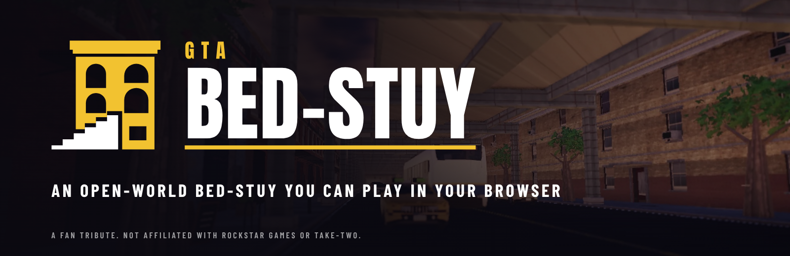

<p align="center">
  
</p>

# GTA Bed-Stuy

GTA Bed-Stuy is a free, non-commercial fan tribute: an open-world, third-person driving and walking game set in
Bedford-Stuyvesant, Brooklyn. You walk the streets, drive, fight a little, take jobs from people on the block, listen to
the car radio, and get chased by the police. It runs in a web browser (Three.js, Vite, TypeScript) and as desktop apps.
Almost everything is generated in code: the streets, the buildings, the people, the cars, the textures and the sound.
It is not affiliated with Rockstar Games or Take-Two Interactive (see the disclaimer at the end).

## Play it

**https://gta-bedstuy.vercel.app**

| Where | What to expect |
|---|---|
| Desktop browser | The main way to play. Needs WebGL 2. The game picks a quality tier from your graphics card. The owner has played it in Chrome on a Mac. |
| Phone browser | Starts on a reduced "phone" tier with on-screen controls. It works but it is rough, and a pass on phones is in progress. It has not been tested on a real iPhone by the studio yet. |
| Mac (Apple Silicon) and Windows apps | Electron builds made by GitHub Actions (`.github/workflows/native.yml`). They are unsigned, they are not on a GitHub Releases page yet, and the first start needs an "Open anyway" step. How to get and run them: [docs/NATIVE.md](docs/NATIVE.md). The studio has not run them on real hardware. |

On the title screen press Space (or Enter, tap the screen, click the prompt, or press A or Start on a gamepad).

Some things below are marked "in development". The live site is built from an older commit than the source in this
repository; the source holds work that has not been checked in the running game and has not been released.

## Controls

These come from `src/core/ControlsHelp.ts`, `src/core/Input.ts`, `src/core/Gamepad.ts`, `src/ui/TouchControls.ts` and the
pause menu's Controls tab (`src/ui/Menu.ts`). The touch column is the released layout. In the source tree it is being
reworked (in development): a stick that appears under your thumb anywhere on the left, GAS, BRAKE and HAND buttons in a car,
and VIEW doubling as look-behind. This column will change when that is released.

The layout follows GTA V on PC (keys and pad) with GTA IV where the two agree: if you know either, your hands are already
in the right place. Bindings are conventions only; nothing is taken from any game. Every keyboard key can be changed in the
pause menu, Controls tab (click a key, press the new one; Backspace clears; Reset to defaults). The pad column shows Xbox
names; a PlayStation pad shows Cross, Circle, Square, Triangle, L1, R1, L2, R2. The sources and how sure each row is are in
`docs/swarm/tasks/CONTROLS.md`.

| Action | Keyboard and mouse | Gamepad | Touch |
|---|---|---|---|
| Move, steer | W A S D | Left stick | Left stick |
| Look | Mouse | Right stick | Drag on the right side |
| Sprint on foot (the default is a jog) | Left Shift | A, hold | RUN |
| Walk slowly | Hold Alt, or toggle Caps Lock | L3 toggles; or half-tilt the left stick | Half-push the stick |
| Jump | Space | X | JUMP |
| Throttle, brake and reverse in a car | W, S | RT, LT | Left stick, BRAKE |
| Handbrake (car) | Space | RB | HAND |
| Punch, throw or shoot (on foot, by the item in hand) | Left click or G | RT | ACT |
| Aim, take cover (reserved, no function yet) | Right click, Q | LT, RB | |
| Next, previous item in hand | Tab or wheel down, wheel up | LB or d-pad right, d-pad left | Tap the item icon |
| Enter or exit a vehicle | F | Y | CAR |
| Camera view (tap twice to swap the last two) | V | View or Select | VIEW |
| Swap over-the-shoulder side | B | RB on foot | |
| Look behind | Hold C | R3 | LOOK |
| Horn (car) | G, hold | L3, hold | HORN |
| Radio next, previous (car) | . and , or wheel | d-pad right, left | RADIO |
| Phone | Up arrow or middle click | D-pad up | PHONE |
| Map | M | Start, then the Map tab | MAP |
| Point at HOME or WAX DELI | N | | Tap the Offer or Nav chip |
| Full screen | Alt+Enter | | |
| Pause menu (opens on the map) | Esc | Start | II |

There is no action button in a car yet. Left Ctrl (stealth in GTA V) is bound to Walk only while the page is in full screen
with the browser's Keyboard Lock active, because Ctrl+W closes a browser tab otherwise. Mission prompts that say R retry
or X abandon use those keys too.

## What is in the game

- **Maps.** The main map is the real Bedford-Stuyvesant street map (hosted site and desktop apps): streets from the city's
  street centrelines, buildings from its tax lots, about 15 km2 with traffic, pedestrians, police, missions and saving.
  The older stylised grid of named streets (sixteen in `src/world/data/bedstuy.json`, centred on Throop Ave and Kosciuszko St)
  is still there: add `?map=grid` (or pick "Map" in Settings), and it is the only map in the single-file build, which carries
  no real-street code or data. Phones open the grid unless the address says `?map=real`, until the real map has been tried on a real
  iPhone (it is heavier in memory). Each map keeps its own save slots; a first visit to the real map with only grid saves starts
  fresh and brings the cash, records and look along.
- **People.** Pedestrians built from open MakeHuman data, with their own clothes, hair, hats and bags, moving with
  captured walking and running motion. Twenty-one body types and a large wardrobe are in development.
- **Vehicles.** The source defines 37 vehicle types (`VEHICLE_SPECS` in `src/entities/Vehicle.ts`): sedans, SUVs, vans,
  pickups, a bus, box, garbage and ice-cream trucks, taxis, police cars, an ambulance, a limo, sports and electric cars.
  The live game has fewer, because the new types are in development.
- **Traffic, police and fighting.** Cars obey signals on the grid map. Crimes raise a wanted level of up to three stars
  and patrol cops chase you. On foot the action button punches, or throws a bottle or brick, or fires a pistol once you
  have picked one up. Nobody is hurt on screen: people go down, get up and run.
- **Missions and story.** Jobs are offered at gold markers on the street. There are three openers (Bodega Run,
  Laundromat Getaway, Block Party), a three-act story called "Air Rights" ([docs/reference/STORY.md](docs/reference/STORY.md)),
  a DJ chain, and optional side jobs. A phone with messages, contacts, goals, a map and settings sits in the game.
- **Radio.** A dial of 15 stations: SoundCloud sets played through SoundCloud's own player, live public radio streams,
  and a scripted talk show, WBSY Talk. Nothing is bundled. DJs and hosts speak with synthesized voices.
  See [docs/RADIO.md](docs/RADIO.md).
- **Places to go in.** HOME, the WAX DELI record shop, and the AFTERSLOTH club (open at night, once a mission unlocks it) with
  DJ decks you can play. An elevated train line you can ride.
- **Weather, day and night.** A day and night cycle. Eight weather kinds on a seeded forecast (clear, partly cloudy,
  overcast, light rain, heavy rain, thunderstorm, fog, windy): in development.
- **Saves and settings.** Saves and settings are kept in your browser (or the app's profile folder).

## Quality settings and URL parameters

There are four tiers: `phone`, `low`, `medium` and `high` (`src/render/QualityTier.ts`). Each has a triangle and draw-call
budget: phone 300,000 and 150, low 500,000 and 220, medium 1,200,000 and 320, high 2,000,000 and 450. The phone tier draws
at a reduced size (the cap is being changed by the phone work in development, see `src/render/QualityTier.ts`), loads no
normal or roughness maps, and keeps a short view distance hidden by fog. The `low` tier does
not yet meet its draw-call budget. Without a parameter the game picks a tier from the graphics card and may step down
once if the frame rate stays low. The pause menu, Settings, has finer controls (resolution, shadows, draw distance,
crowd and traffic density, anti-aliasing, bloom and more).

| Parameter | Effect |
|---|---|
| `?q=phone`, `?q=low`, `?q=medium`, `?q=high` | Start on that tier and never step down on your own. |
| `?q=ultra` | Hosted builds only: `high` with 16x anisotropic filtering. |
| `?map=grid` (or `?map=classic`) | Hosted and desktop-app builds: the older stylised grid map instead of the real streets (the default there). The single-file build is always the grid. |
| `?debug=gfx` | A panel with the graphics card, tier and passes, switches to turn effects off, and a Copy report button. Used for bug reports ([docs/PLATFORM-CHECK.md](docs/PLATFORM-CHECK.md)). |
| `?debug=mem` | A memory overlay, for phone testing. |
| `?perf=0` | Keep the chosen tier; no automatic step-down. |
| `?lod=0`, `?proxies=0` | Measurement switches: full-detail cars everywhere, full shadow scenes. |

## Run it yourself

You need Node 20.19 or newer (`engines` in `package.json`; the CI builds use Node 22).

```
npm install
npm run dev            # dev server, open the printed URL
npm run typecheck      # tsc --noEmit
npm test               # vitest, the whole suite (see below)
```

- **Single-file build:** `npm run build` writes one self-contained `dist/index.html` (budget 12 MB). `npm run artifact`
  also writes `dist/artifact.html`. It has no real-map code or data.
- **Hosted build** (what Vercel serves): `npm run build:hosted` writes `dist-hosted/` with hashed asset files.
  Vercel runs `VITE_HOSTED=1 npm run build`. `npm run build:all` builds both and checks their sizes, and
  `npm run smoke:hosted` loads the hosted build headless. To look at it: `npx vite preview --outDir dist-hosted --port 4307`.
- **Tests:** the whole suite at once is heavy. Run one folder at a time:
  `npx vitest run tests/unit/entities --maxWorkers=1`. `npm run test:e2e` is a browser smoke test and needs Playwright and
  Chromium, which are not in `package.json`.
- **Desktop apps:** `npm run native:install`, then `npm run native:dev`, `npm run native:build:mac` or
  `npm run native:build:win`. Details in [docs/NATIVE.md](docs/NATIVE.md).

More for contributors: [CONTRIBUTING.md](CONTRIBUTING.md).

## Map of the repository

| Path | What is there |
|---|---|
| `src/main.ts` | Assembly and the frame loop. Only the project lead edits it. |
| `src/core`, `src/physics` | Input, camera, events, math; the flat 2D physics world. |
| `src/world` | The grid map, building and street generators, and `roadnet/` for the real-street map. |
| `src/entities` | Player, pedestrians, vehicles, traffic and police agents; `models/` builds people and cars; `anim/` holds motion. |
| `src/textures`, `src/render` | Procedural texture painters and materials; the render pipeline, quality tiers, culling. |
| `src/game`, `src/audio`, `src/ui` | Missions, traffic, police, weather, combat; mixer, vehicles, voices, radio; HUD, menus, map, phone. |
| `public/` | Fonts, title pictures, voice banks, animation pack, real-map data tiles, the link-in-bio page. |
| `native/` | The Electron shell for the Mac and Windows apps. |
| `tests/`, `scripts/`, `playtests/` | Unit and browser tests; build, data-import and render scripts; playtest reports. |
| `docs/` | All documentation, indexed in [docs/README.md](docs/README.md). `MEMORY.md` at the root is the standing project memory. |

## How it is made

The world, people, cars, textures and sound are generated by code from small data files. Third-party material is limited to
open sources, each recorded with its licence in [docs/CREDITS.md](docs/CREDITS.md): CC0 texture sets (ambientCG, Poly
Haven), the CC0 MakeHuman base-mesh data, captured motion from the CMU Graphics Lab database, Anton and Barlow fonts under
the SIL Open Font Licence, and neural voices (Kokoro, Apache-2.0) rendered ahead of time into the voice pack. Map data is
NYC Open Data (street centrelines, MapPLUTO tax lots, building footprints, signals, street furniture), plus wall colours
read from openly licensed street photos (Wikimedia Commons, KartaView). No Google Maps or Street View data is used. Real
places appear under invented names.

## Rules for contributors

The owner's standing rules are in [MEMORY.md](MEMORY.md). The short version:

- No assets, fonts, logos, sounds or traced art from any game. GTA is a style reference only.
- Open data and CC0, CC-BY or CC-BY-SA assets only, each recorded in `docs/CREDITS.md`. No Google Maps or Street View.
- Shops, brands and liveries are parodies with invented names. No lettering or logos on clothes.
- No blood or gore; nobody dies on screen.
- Keep `src/` compiling (`npx tsc --noEmit`). Only the lead edits `src/main.ts`. Never `git stash`.
- A commit message containing "work in progress" is not deployed; a plain message deploys to production.
- Say what is verified and what is not. Never quote frame rates measured on a software renderer.

## Credits

Created and directed by Carlos Franzetti. The studio staff credited in the game and in
[docs/CREDITS.md](docs/CREDITS.md) are AI agents working under his direction.

## Privacy

The live site counts page views with Vercel Web Analytics. It sets no cookies and the game stores nothing about you on a
server: saves and settings stay in your browser. The single-file build and the desktop apps count nothing.

## Disclaimer

This is a fan tribute, not affiliated with, endorsed by, or connected to Rockstar Games or Take-Two Interactive.
"Grand Theft Auto" and "GTA" are their trademarks. This project uses none of their assets, code, music, characters or
logos. Every business name in the game is an invented parody of a type of business, not of any real shop or person.

## Licence

There is no licence file in the repository yet, so no reuse rights are granted for the project's own code and art. Third-party
assets keep the licences listed in [docs/CREDITS.md](docs/CREDITS.md).
